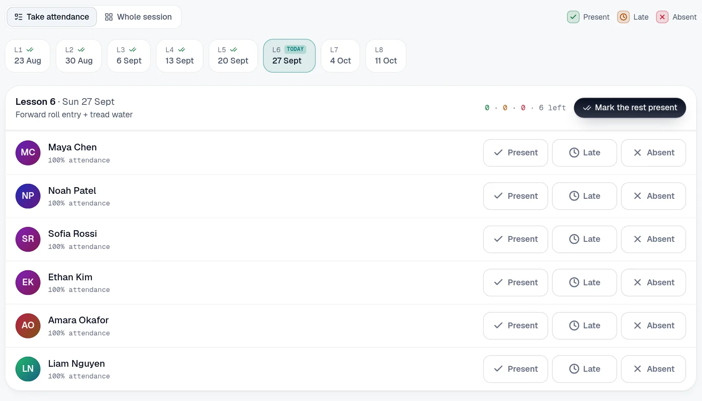

# Lanemark

Lanemark is a record book for swim instructors. It handles attendance, lesson plans, skill check-offs and report
cards, so the paperwork side of teaching a level doesn't eat your evening. It runs in the browser and as an Android app,
and it keeps working on a pool deck with no signal.

It follows the Lifesaving Society's Swim for Life levels, from Parent & Tot through Bronze Star plus Teen/Adult. That's
21 levels and 265 skills. Every class gets its own editable copy of its level's skills.

**Live:** [lanemark.fly.dev](https://lanemark.fly.dev). Press *Try the live demo* to look around without an account.
The demo keeps everything in your browser.

<picture>
  <source media="(prefers-color-scheme: dark)" srcset="public/guide/dashboard-dark.webp">
  
</picture>

| Taking attendance | Writing a report card |
|---|---|
| <picture><source media="(prefers-color-scheme: dark)" srcset="public/guide/attendance-dark.webp"></picture> | <picture><source media="(prefers-color-scheme: dark)" srcset="public/guide/report-card-dark.webp"></picture> |
| **Supervisor overview** | **The printed card** |
| <picture><source media="(prefers-color-scheme: dark)" srcset="public/guide/pool-dark.webp"></picture> | <picture><source media="(prefers-color-scheme: dark)" srcset="public/guide/preview-dark.webp"></picture> |

## What it does

- **Attendance and lessons.** Mark each swimmer with one tap: here, late, absent. Plan what each lesson covers, and
  fill in a season's dates in one go.
- **Skills.** A grid of swimmers against skills, or one swimmer at a time on a phone.
- **Report cards.** Tick the skills, get a draft comment built from each skill's coaching cues, then check it
  against the usual report card rules and print letter-size cards for a swimmer or the whole class.
- **Pools.** Instructors join their facility with an invite code. Supervisors see every class: what's behind, why,
  and how caught up each instructor is. They can open any class read-only.
- **Works offline.** Edits save on the device first and sync when there's a connection. A service worker keeps the
  app itself cached.
- **Accounts done properly.** Email confirmation and reset, TOTP two-factor with recovery codes, device list and
  security emails. On Android, the app can unlock with your fingerprint.

There's a [how-to guide with pictures](docs/GUIDE.md). It's also in the app under Help.

## Stack

| | |
|---|---|
| Frontend | React 19, TypeScript, Vite, Tailwind CSS 4, Zustand, Motion |
| Offline sync | Own engine (`src/sync/`): diffs the store, queues changed documents in IndexedDB, pushes and pulls through one endpoint |
| Server | Hono on Node 24+, running the TypeScript directly (no build step) |
| Database | Built-in `node:sqlite` by default, or MongoDB Atlas with one environment variable |
| Android | Capacitor 8 around the same React app, plus two small Java plugins (Keystore-backed unlock and printing) |
| Tests | Vitest: about 170 tests over crypto, auth and 2FA, sync, both databases, report card rules and UI logic |
| Hosting | One Docker image on Fly.io (Toronto), deployed from GitHub Actions |

## Running it

Needs Node 24 or newer.

```bash
npm install
npm run seed   # optional: a local account with three sample classes (it prints the login)
npm run dev    # site on http://localhost:5173, API on :8787
```

| Script | |
|---|---|
| `npm run dev` | Site and API with hot reload |
| `npm test` | The test suite |
| `npm run lint` | oxlint |
| `npm run build` | Type-check and build the site into `dist/` |
| `npm start` | Production server: API and built site on one port |
| `npm run app` | Build the Android test APK ([docs/MOBILE.md](docs/MOBILE.md)) |
| `npm run tunnel` | Share your local build over a Cloudflare quick tunnel |

Copy `.env.example` to `.env` for email, MongoDB or the in-app assistant. Everything works without it: emails show
up at `/api/dev/outbox` in development.

## Layout

```
src/
  pages/          screens (dashboard, class, report cards, pool, settings…)
  components/     shared UI, the app shell, landing page
  store/          Zustand stores: data, session, pool, UI
  sync/           offline-first sync engine
  data/           curriculum presets, report card must-sees, the help guide
  native/         Android-only bits: unlock, keep-awake, back button
server/
  app.ts          routes: auth, 2FA, sessions, sync, pools, assistant
  auth/           scrypt passwords, TOTP, recovery codes
  db/             one storage interface, SQLite and MongoDB implementations
  test/           server tests
android/          Capacitor project and the Java plugins
docs/             guide, hosting and Android notes
```

## How a few things work

**Sync.** Classes and swimmers are documents. Every store change is diffed by reference, and the touched documents
are queued. One `POST /api/sync` sends them and gets back everything that changed elsewhere since the last cursor,
deletions included. Anything edited while a request is in flight keeps its local version. Last write wins per
document.

**Security.** Passwords are hashed with scrypt, using constant-time checks and dummy work for unknown emails. Session
tokens are opaque and only their hashes are stored. Cookies are httpOnly and SameSite. Writes need a same-origin
request with a JSON body. There are rate limits per address and per account. TOTP secrets are encrypted at rest with
AES-256-GCM. Every synced document is validated with zod, and there's a strict CSP. The Android app uses a bearer
token instead of cookies. The details are in [docs/MOBILE.md](docs/MOBILE.md).

**Privacy.** There are no analytics and no third-party scripts. Swimmer data only goes to the Lanemark server. The
assistant only ever sees class summaries, never names. See `/privacy` in the app.

## Deploying

It's one Node process serving the API and the site, with a `Dockerfile` and `fly.toml` included. Pushing to `main`
runs the checks and deploys to Fly once a `FLY_API_TOKEN` secret is set. Without it, the deploy job just skips.
[docs/HOSTING.md](docs/HOSTING.md) covers Fly, Railway, email and MongoDB setup step by step. To deploy from your own
machine, `npm run ship` pulls, checks, commits, pushes and deploys in one go.

## About the curriculum

The levels, skills and distances follow the Lifesaving Society's Swim for Life *At-a-Glance* guides. The coaching
cues and report card wording are Lanemark's own. Lanemark isn't affiliated with or endorsed by the Lifesaving
Society. "Swim for Life" and the level names are theirs.

## About

Made by [gulb1t](https://github.com/gulb1t). I built Lanemark because keeping a class on paper and then typing up
report cards at the end of the session took way too long. Claude Code helped with parts of the code.

## License

No license has been chosen yet, so the code is all rights reserved for now. Feel free to read it. Ask before reusing
it.
