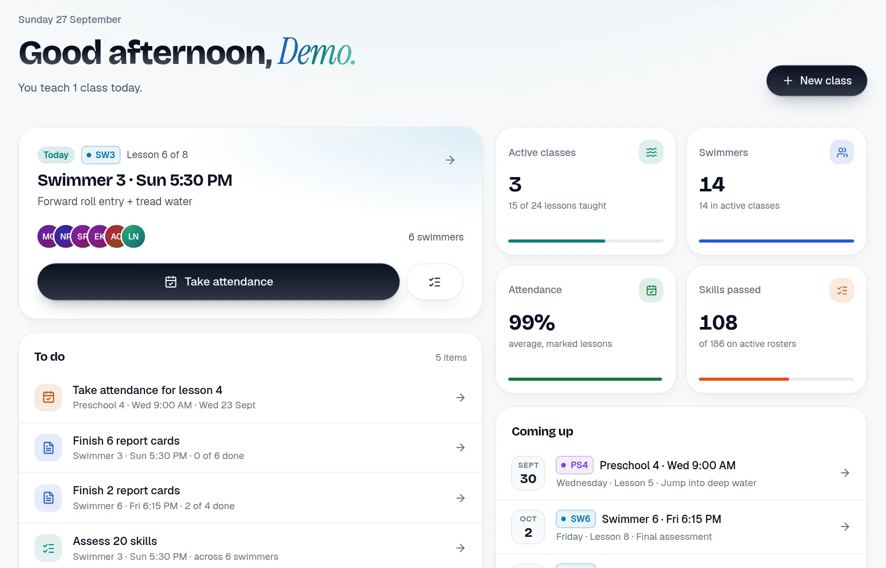
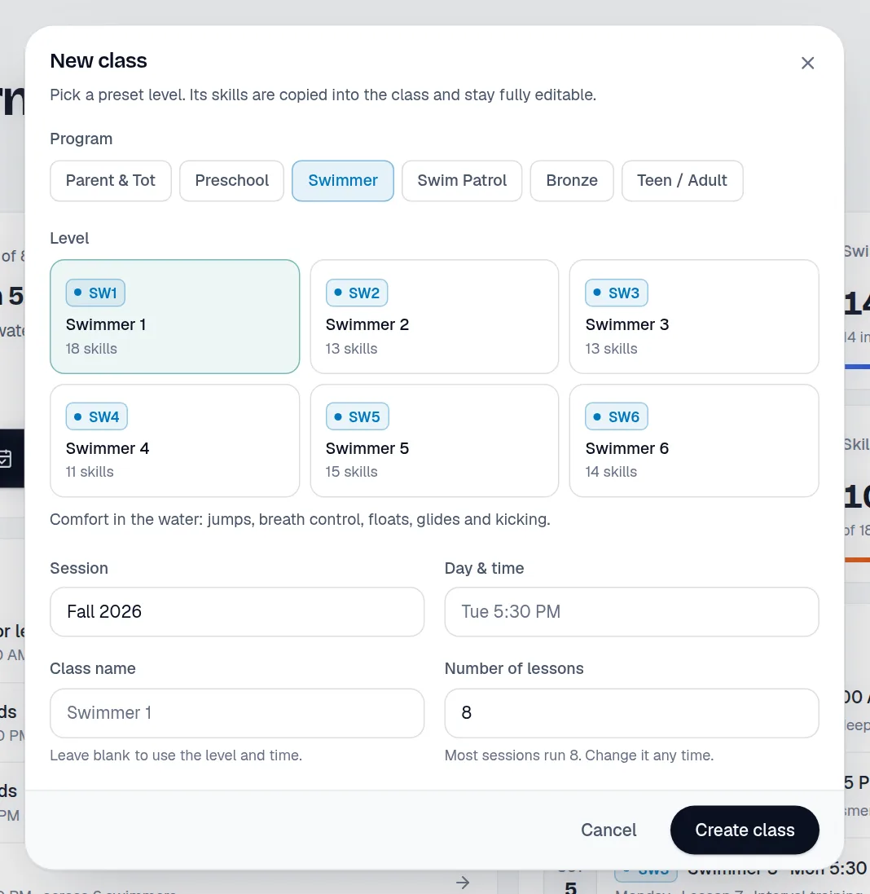
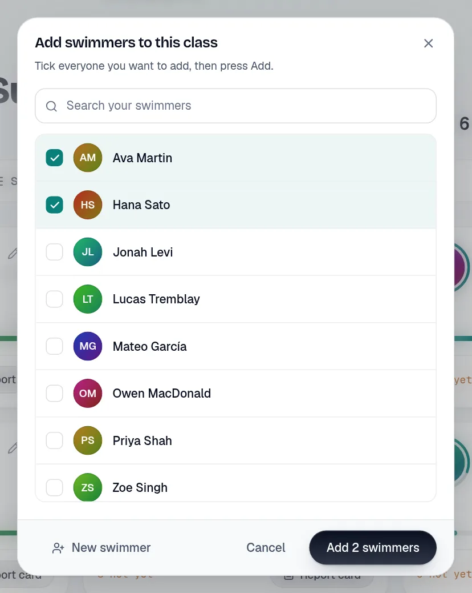
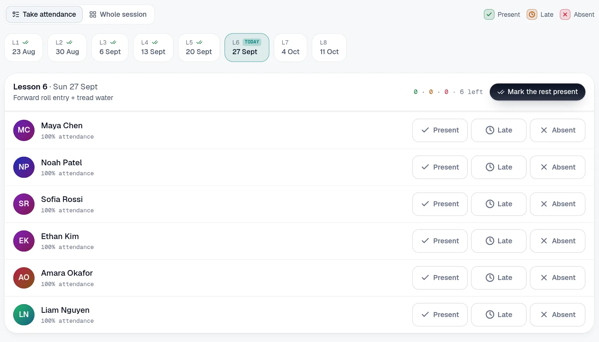
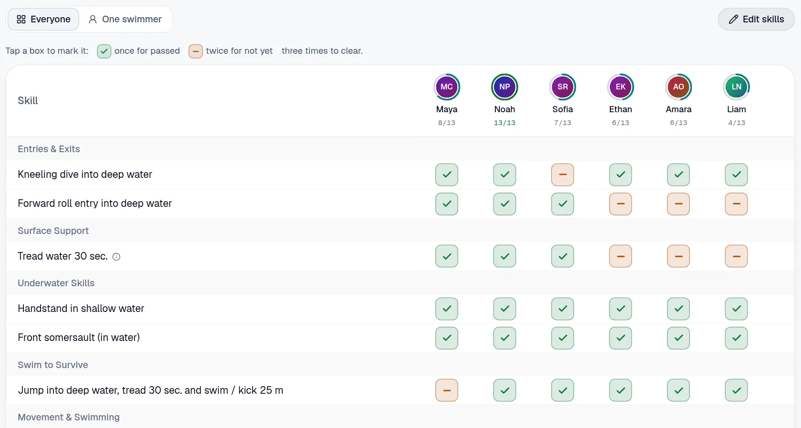
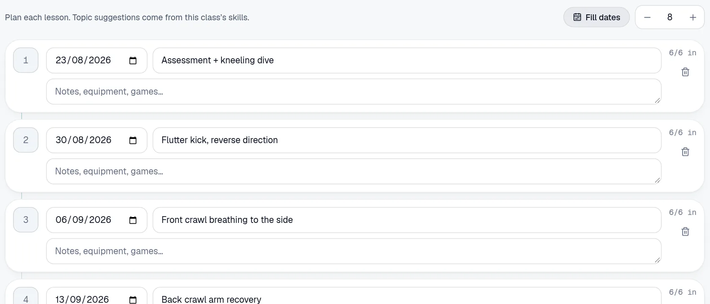
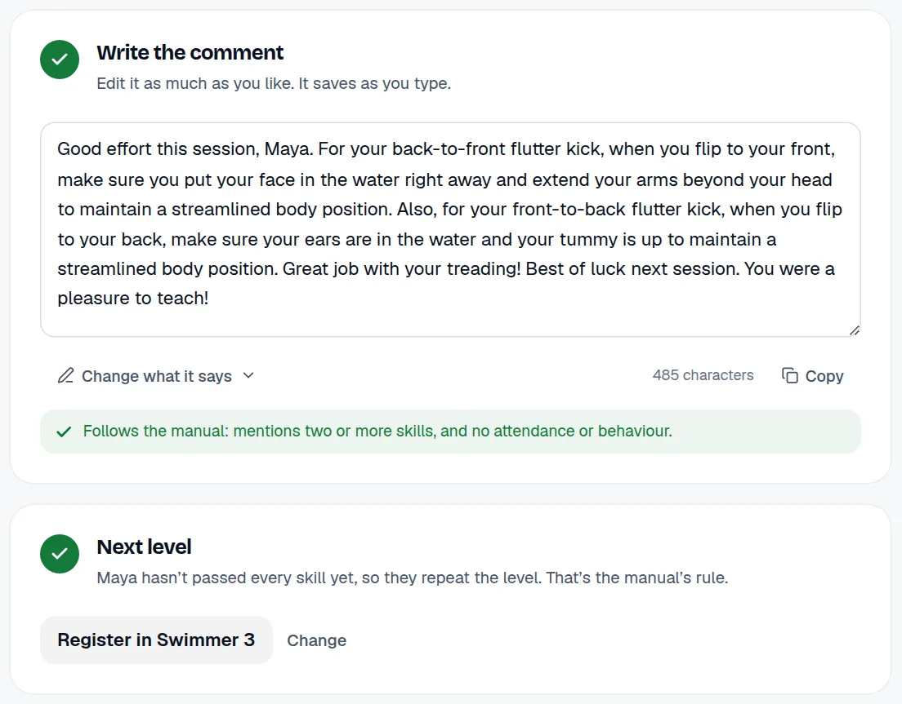
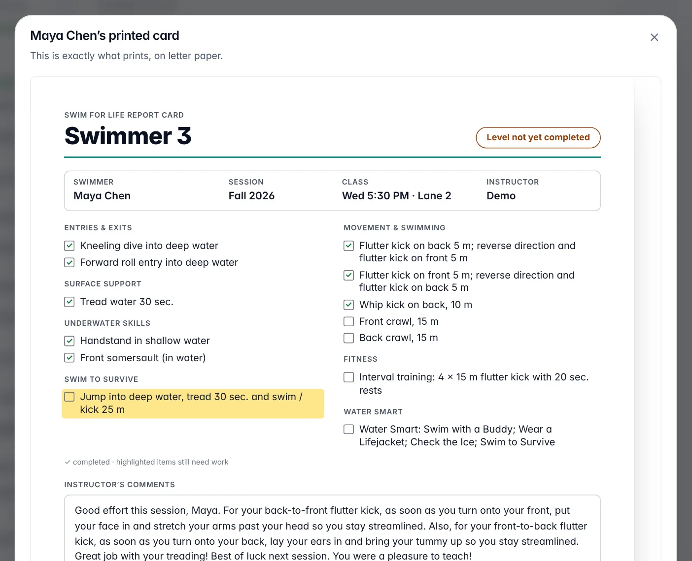
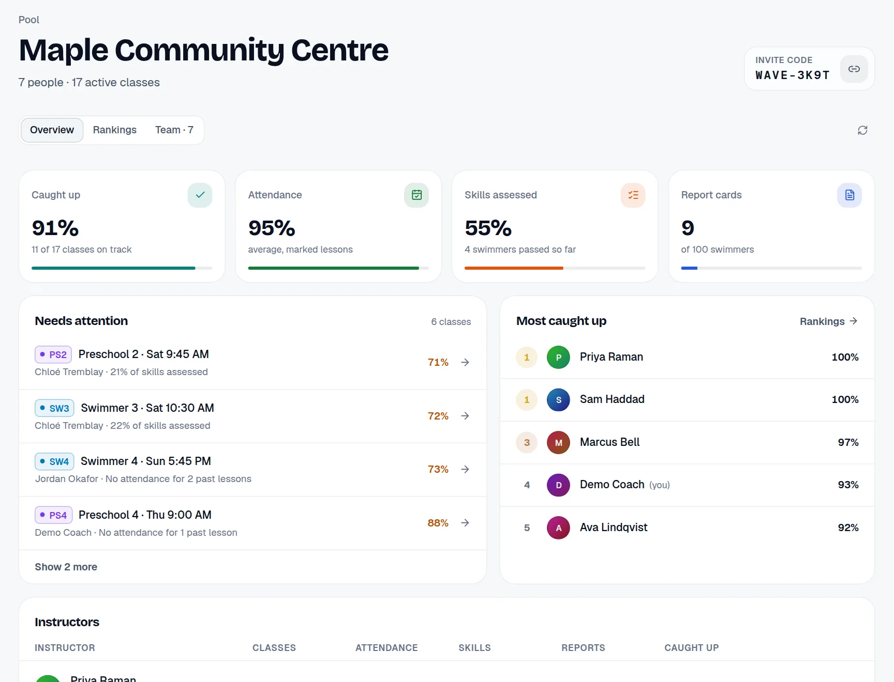

# How to use SwimTrack

<!-- Generated from src/data/guide.ts by `npm run guide:md`. Edit that file, not this one. -->

The same guide is in the app under **Help** (`/help`), where every “Try it” opens the real screen. You can also [try the demo](https://swimtrack.fly.dev/demo).

## Contents

- **Getting started:** [Your home screen](#first-look) · [Make a class](#new-class) · [Add swimmers](#add-swimmers)
- **Every lesson:** [Take attendance](#attendance) · [Check off skills](#skills) · [Plan your lessons](#lesson-plans)
- **Report cards:** [Write report cards](#write-reports) · [Print or download](#print) · [Report card rules](#manual-rules)
- **Pools and supervisors:** [Join your pool](#join-pool) · [Supervise a pool](#supervise)
- **Your account:** [Working without Wi-Fi](#offline) · [Undo a mistake](#mistakes) · [Keep your account safe](#security)

## Getting started

Set up once at the start of a session. It takes about five minutes.

### Your home screen

_Today’s classes, what’s left to do, and all your classes in one place._

1. Classes you teach **today** show up first, with a big **Take attendance** button.
2. The **To do** list shows what’s left: attendance you missed, skills to check and report cards that are due. Tap an item to go straight there.
3. Below that are **all your classes**. Tap one to open it.

> 💡 The first time you open a page, a short tour points out the important parts. To see them again, go to **Help → Replay the tour**.

<picture>
  <source media="(prefers-color-scheme: dark)" srcset="../public/guide/dashboard-dark.webp">
  
</picture>

[Try it in the demo →](https://swimtrack.fly.dev/demo?go=dashboard)

### Make a class

_Pick the level and SwimTrack loads its skills for you._

1. Press **New** at the top of the screen, then **New class**. (On a phone, press **New** next to your classes on the home screen.)
2. Pick the **level**, for example Swimmer 3. Its skills from the Swim for Life manual are loaded in automatically.
3. Add the **session** (like Fall 2026) and the **day and time**. The class name fills itself in.
4. Choose the **number of lessons**, then press **Create class**.

> 💡 Every class gets its own copy of the skills, so you can rename or add skills in one class without changing the others.

<picture>
  <source media="(prefers-color-scheme: dark)" srcset="../public/guide/new-class-dark.webp">
  
</picture>

[Try it in the demo →](https://swimtrack.fly.dev/demo?go=new-class)

### Add swimmers

_Add new swimmers, or put swimmers you already have into a class._

1. Open the class and go to the **Swimmers** tab.
2. Press **Add swimmers**.
3. **Tick** everyone you want in this class, then press **Add**. Nothing changes until you press it.
4. Someone new? Press **New swimmer**, type their name and press **Add to class**.

> 💡 To take a swimmer out of a class, press the person icon on their card. SwimTrack asks first and tells you what will be removed.
>
> 💡 A swimmer can be in more than one class. Their profile shows every class they’re in.

<picture>
  <source media="(prefers-color-scheme: dark)" srcset="../public/guide/add-swimmers-dark.webp">
  
</picture>

[Try it in the demo →](https://swimtrack.fly.dev/demo?go=swimmers-tab)

## Every lesson

On deck, with wet hands. Big buttons, and it works without Wi-Fi.

### Take attendance

_A few taps at the start of each lesson._

1. On the home screen, press **Take attendance** on today’s class. (Or open the class and go to the **Attendance** tab.)
2. Tap each swimmer’s button: once for **Present**, twice for **Late**, three times for **Absent** (a fourth tap clears it).
3. Everyone else is here? Press **Mark the rest present**.
4. When everyone is marked you’ll see **attendance done**, with a shortcut to check skills.

> 💡 Tapped the wrong one? Just tap the right one.
>
> 💡 Missed a lesson? Pick it from the row of lessons at the top, or the To do list will remind you.

<picture>
  <source media="(prefers-color-scheme: dark)" srcset="../public/guide/attendance-dark.webp">
  
</picture>

[Try it in the demo →](https://swimtrack.fly.dev/demo?go=attendance)

### Check off skills

_Mark each skill as passed or not yet, for the whole class or one swimmer at a time._

1. Open the class and go to the **Skills** tab.
2. **Everyone** shows a grid: skills down the side, swimmers across the top. Tap a box once for **passed** (✓), twice for **not yet** (–), three times to clear it.
3. **One swimmer** shows a single swimmer with a **Passed** and a **Not yet** button for each skill. It’s easier on a phone.
4. When a swimmer passes every skill, SwimTrack celebrates and their report card switches to the passing wording.

> 💡 Tap a skill’s name in the One swimmer view to see what the manual says to look for.

<picture>
  <source media="(prefers-color-scheme: dark)" srcset="../public/guide/skills-dark.webp">
  
</picture>

[Try it in the demo →](https://swimtrack.fly.dev/demo?go=skills)

### Plan your lessons

_A topic, date and notes for each lesson._

1. Open the class and go to the **Lessons** tab.
2. Type a **topic** for each lesson. Suggestions come from the class’s skills.
3. Press **Fill dates**, pick the **first lesson** and how often it **repeats** (weekly for most sessions), then press **Fill dates** again. Every lesson gets its date.
4. Use **+** and **–** to change how many lessons there are.

> 💡 Lessons need dates for today’s class to show up on your home screen.

<picture>
  <source media="(prefers-color-scheme: dark)" srcset="../public/guide/lessons-dark.webp">
  
</picture>

[Try it in the demo →](https://swimtrack.fly.dev/demo?go=lessons)

## Report cards

At the end of the session. SwimTrack writes the comments from the manual; you check them.

### Write report cards

_One swimmer at a time, in three steps._

1. Open the class, go to the **Report cards** tab and press **Start writing**.
2. **Step 1, skills:** tap **Passed** or **Not yet** for each skill. (Already done in the Skills tab? It’s filled in here too.)
3. **Step 2, the comment:** press **Write it for me**. SwimTrack writes it from the skills, in the report card manual’s own words. Read it and change anything you like.
4. Want it to praise something else, or mention different things to work on? Press **Change what it says** and pick.
5. **Step 3, next level:** already filled in. A swimmer moves up only when every skill is passed.
6. Press **Next** to go to the next swimmer. Everything saves as you go.

> 💡 A green check next to a step means it’s done. The bar at the bottom shows how many cards are finished.
>
> 💡 In a hurry? On the Report cards tab, **More → Write the missing comments** writes one for everyone who doesn’t have one. Read them before you print.

<picture>
  <source media="(prefers-color-scheme: dark)" srcset="../public/guide/report-card-dark.webp">
  
</picture>

[Try it in the demo →](https://swimtrack.fly.dev/demo?go=report-card)

### Print or download

_Letter-size report cards, one per page, or a spreadsheet of the whole class._

1. While writing, press **Preview** to see exactly what will print.
2. Press **Print**, then choose **one swimmer’s card** or the **whole class**.
3. For records, go to the **Report cards** tab and press **More → Download as a spreadsheet**. It opens in Excel or Google Sheets.

> 💡 In the print window, choose Letter paper and turn off headers and footers for the cleanest cards.

<picture>
  <source media="(prefers-color-scheme: dark)" srcset="../public/guide/preview-dark.webp">
  
</picture>

[Try it in the demo →](https://swimtrack.fly.dev/demo?go=reports)

### Report card rules

_What the report card manual asks for, and how SwimTrack helps._

1. Comment on **at least two** skills. SwimTrack warns you if a comment names fewer.
2. Never mention **attendance or behaviour**. SwimTrack flags words like “absent” or “listening”.
3. A swimmer passes a level only when **every** skill is passed. Otherwise they register in the same level again.
4. Keep it positive and specific: something they did well, then what to work on next.

> 💡 A green “Follows the manual” note under the comment means it meets these rules.

## Pools and supervisors

For facilities: instructors join a pool, supervisors see every class.

### Join your pool

_For instructors. It takes one code._

1. Your supervisor sends you an invite link or an 8-character code.
2. Open the link (or go to **Settings → Account → Join or start a pool** and type the code).
3. Read what supervisors can see, then press **Join pool**.

> 💡 Supervisors can see your classes, swimmers, attendance, skill marks and report card comments. They can’t change anything.
>
> 💡 You can leave any time from the Pool tab. They stop seeing your classes straight away.

### Supervise a pool

_Every class’s progress in one place, and who needs a hand._

1. Go to **Settings → Account → Join or start a pool**, then **Start a pool**.
2. On the **Team** tab, copy the **invite link** and send it to your instructors.
3. The **Overview** shows how caught up every class is. **Needs attention** lists classes that are behind, and why.
4. Tap any class to see it in full: swimmers, attendance, skills and comments. You can print its report cards or download it.
5. **Rankings** orders classes and instructors by how caught up their records are. Swimmers are never ranked.

<picture>
  <source media="(prefers-color-scheme: dark)" srcset="../public/guide/pool-dark.webp">
  
</picture>

[Try it in the demo →](https://swimtrack.fly.dev/demo?go=pool)

## Your account

Safe, and it keeps working when the Wi-Fi doesn’t.

### Working without Wi-Fi

_Everything saves on your device first._

1. Keep working as normal. Every change saves on your phone, tablet or laptop straight away.
2. The little status pill at the top says **Saved**, **Saving** or **Offline**.
3. When you’re back online, SwimTrack syncs by itself, so your other devices catch up.

> 💡 Open SwimTrack once on each device while you have signal. After that it opens even with none.

### Undo a mistake

_Nothing important happens without asking._

1. Removing or deleting anything asks you first, and says exactly what will be removed.
2. After you remove something, or change several things at once, an **Undo** button pops up for a few seconds. Tap it to put things back.
3. Want a copy of everything? **Settings → Data → Export backup**.

### Keep your account safe

_Two-factor sign-in, and a list of your devices._

1. Turn on **two-factor** in **Settings → Security**. You’ll use a code from an authenticator app when you sign in.
2. Save your **recovery codes** somewhere safe, in case you lose your phone.
3. **Settings → Devices** lists where you’re signed in. Sign out any device you don’t recognise.
4. Forgot your password? Press **Forgot password?** on the sign-in page and we’ll email you a link.

[Try it in the demo →](https://swimtrack.fly.dev/demo?go=settings)
